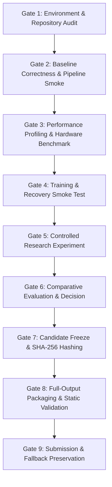

# SAT-EURS Safety-First Master Execution Plan
## EURS / MaCVi WACV 2027 Challenge (Tracks 1 & 2)
**Hardware Profile:** NVIDIA GeForce RTX 5090 (32 GB VRAM) | 64 GB DDR5 RAM | Intel Core Ultra 9 285K (24 cores) | Windows 11  
**Project Workspace:** `C:\Projects\SAT-EURS`  
**Date:** October 16, 2026 | Local Time: 13:47 IST  
**Version:** 1.0.0 (Gate 1 Baseline Locked)  

---

## 1. Executive Mission & Core Objectives

The mission of this project is to advance EURS Track 1 and Track 2 competitive performance through rigorous, evidence-driven experimentation on our dedicated RTX 5090 workstation while maintaining rock-solid system stability, data integrity, and deployment compliance at every stage.

### Three Co-Equal Objectives:
1. **Objective A — Accuracy:** Maximize the official composite competition metric:
   $$S_{\text{composite}} = 0.60 \cdot Q_{\text{seg}} + 0.30 \cdot Q_{\text{FR}} + 0.10 \cdot Q_{\text{NR}}$$
   where $Q_{\text{seg}} = \text{Macro } F_1 \times \text{mIoU} \times \text{coverage\_penalty}$ and $Q_{\text{FR}} = 0.45 \cdot \text{PSNR}_{\text{norm}} + 0.45 \cdot \text{SSIM} + 0.10 \cdot \text{sharpness\_ratio}$.
2. **Objective B — Speed & Throughput:** Eliminate CPU/GPU idle time, benchmark data loading and batch execution, exploit Blackwell hardware capabilities (TF32, BF16, fast convolutions), and minimize training and TTA latency.
3. **Objective C — Stability & Provenance:** Operate within strictly monitored VRAM/RAM guardrails, enforce atomic checkpointing, maintain verified fallback submissions at all times, and prevent in-sample or cross-scene data leakage.

---

## 2. Nine Rigorous Phase Gates

Progression across development occurs exclusively through verified Phase Gates. No full training or destructive action is permitted without satisfying gate deliverables.

### Detailed Gate Specifications:
* **Gate 1 — Environment & Repository Audit [CURRENT GATE]:** Inspect hardware, Python/PyTorch versions, dataset structure, checkpoints, and candidates. Establish resource policies, baseline manifests, and submission checklists. Zero destructive operations or full training runs.
* **Gate 2 — Baseline Correctness:** Execute the existing end-to-end inference and evaluation pipeline on a bounded set of representative samples. Verify image dimensions, discrete mask classes $\{0,1,2,3,4\}$, metric calculations, and checkpoint loading.
* **Gate 3 — Performance Baseline:** Benchmark data-loader throughput (workers 2, 4, 6, 8) and model forward/backward passes. Determine hardware bottlenecks (compute vs memory vs host transfer). Establish safe optimal physical batch sizes.
* **Gate 4 — Training & Recovery Smoke Test:** Run 3 forward/backward steps, optimizer step, validation step, and atomic checkpoint save/reload cycle with simulated interrupt recovery.
* **Gate 5 — Controlled Research Experiment:** Execute single hypothesis-driven training or inference modification using strict 5-fold cross-validation or clean OOF held-out evaluation.
* **Gate 6 — Comparative Evaluation:** Benchmark candidate strictly against the locked baseline using identical held-out scenes, evaluator code, and metrics. Issue a definitive `KEEP`, `REJECT`, or `RETEST` decision.
* **Gate 7 — Candidate Freeze:** Freeze state dict, preprocessing hyperparameters, and export artifacts. Compute SHA-256. Store in an immutable directory.
* **Gate 8 — Full-Output Packaging & Validation:** 
  - Track 1: Generate complete 1,200 restored images and 1,200 discrete masks; execute `tools/resize_for_submission.py`; verify archive structure and SHA-256.
  - Track 2: Export single standalone ONNX; verify static tensor shape `[1, 3, 1024, 1024]`; run `deploy/check_submission_flops.py` ($\le 12\text{ GFLOPs}$, $\le 1.0\text{M}$ params); run ONNX Runtime numerical equivalence test against PyTorch.
* **Gate 9 — Submission & Fallback Preservation:** Upload only after all Gate 8 tests pass. Log submission ID, timestamp, and official scores. Retain previous best submission archive as instant rollback fallback.

---

## 3. Track-Specific Engineering Roadmaps

### Track 1: Unconstrained High-Capacity Server Leaderboard
* **Current Official Baseline:** Submission `#18713` (`EURSNetV6Verified`)  
  $$\text{Composite} = 0.6890, \quad Q_{\text{seg}} = 0.6760, \quad \text{PSNR} = 25.41\text{ dB}, \quad \text{SSIM} = 0.816, \quad \text{Sharpness} = 0.960$$
* **Current Verified Fallback Archive:** `deploy/eurs_track1_dryrun_compact_candidate.zip` (564.91 MB, SHA-256: `d6f4b9dfae2a084154d4820722fea48276fe1d5ae8a115557ea36417c3f7d2d6`).
* **Key Components & Provenance:**
  - Restoration: 20-scene closed-form RSUIGM polynomial table (`checkpoints/track1_screening/tbl19_20sc_clean.pt`) + 1.34 unsharp masking (JPEG Q98).
  - Segmentation: 5-Fold DINOv2-Large (`dinov2_vitl14`, blocks 5, 11, 17, 23) with multi-scale TTA (`[448, 518, 588]` + horizontal flips = 6 views per fold, 30 views total).
* **Research Hypotheses to Investigate:**
  1. *Physics-Guided NAFNet Restoration:* 8-channel input (RGB + $I_{\text{poly}}$ + $1 - R$ + DCP) with bounded residual learning ($I_{\text{poly}} + 0.15 \tanh(\text{net}(X))$) to improve PSNR beyond 25.41 dB without introducing edge halos or color clipping.
  2. *Complementary ConvNeXt-Large / UPerNet:* Evaluate whether ConvNeXt features complement DINOv2 self-attention maps via calibrated probability blending ($P_{\text{blend}} = (1-w)P_{\text{DINO}} + w P_{\text{ConvNeXt}}$), specifically targeting rare classes (Elasmobranch, Other).
  3. *Leakage-Safe OOF Evaluation:* Distinguish strict scene-disjoint cross-validation (fitting RSUIGM on 16 scenes, evaluating on 4 held-out scenes) from the global 20-scene table used in official server submissions.

### Track 2: Jetson AGX Orin Edge Deployment
* **Current Official Baseline:** Submission `#18699` (`EURS-Net V5-Calib`)  
  $$\text{Composite} = 0.3380, \quad Q_{\text{seg}} = 0.2450, \quad \text{PSNR} = 17.10\text{ dB}, \quad \text{SSIM} = 0.8210, \quad \text{Params} = 0.7683\text{M}, \quad \text{FLOPs} = 9.05\text{ GFLOPs}$$
* **Current Compact Candidate:** `EURSEdgeSOTA-V2` / `EURSEdgeSOTA-V3` (`deploy/eurs_edgesota_v2_final.onnx` / `deploy/EXP-COMBINED-BEST.onnx`)  
  $$\text{Params} = 0.3537\text{M}, \quad \text{FLOPs} = 2.2496\text{ GFLOPs}, \quad \text{Local } Q_{\text{seg}} = 0.3314, \quad \text{Projected Composite} = 0.4074$$
* **Hardware & Deployment Constraints (JetPack 7.2.1 / Orin 30W Mode):**
  - Input: Static float32 tensor `[1, 3, 1024, 1024]` in range $[0, 1]$.
  - Outputs: Exactly two static tensors:
    - `restored_image`: `[1, 3, 1024, 1024]` in range $[0, 1]$.
    - `seg_logits`: `[1, 5, 1024, 1024]` containing raw floating-point logits in class order `[Background, Coral, Fish, Elasmobranch, Other]`.
  - Hard Limits: $\le 12.0\text{ GFLOPs}$ total compute and $\le 1.0\text{M}$ parameters under `deploy/check_submission_flops.py`.
  - Self-Contained: Single standalone `.onnx` file with embedded weights (no `.onnx.data` sidecars). Zero metadata or filename-based routing dependencies.

---

## 4. Cross-Validation & Data-Leakage Mandate

The 20 clean training scenes are partitioned into 5 disjoint folds in `splits/manifest_5fold.json`:
- **Fold 0:** Val = `['fish1', 'fish11', 'fish12', 'seahorse1']` | Train = remaining 16 scenes
- **Fold 1:** Val = `['fish13', 'fish14', 'fish15', 'sharkFish']` | Train = remaining 16 scenes
- **Fold 2:** Val = `['fish17', 'fish18', 'fish2', 'ray1']` | Train = remaining 16 scenes
- **Fold 3:** Val = `['fish20', 'fish21', 'fish4', 'starfish2']` | Train = remaining 16 scenes
- **Fold 4:** Val = `['fish5', 'fish7', 'fish9', 'turtles1']` | Train = remaining 16 scenes

### Leakage Prevention Rules:
1. All 200 degraded variations of a scene reside in the exact same fold as their clean parent scene.
2. For local OOF benchmarking, RSUIGM polynomial lookup tables, normalization statistics, and thresholds must be fitted strictly on the 16 training scenes of that fold.
3. Checking on the 6 Dev test scenes (`fish10`, `fish19`, `fish3`, `fish6`, `sharRayFish`, `starfish1`) is permissible only for final test-set submission packaging, as ground-truth masks are strictly withheld.

---

## 5. Risk Assessment & Rollback Protocol

| Risk Event | Severity | Probability | Automated Mitigation & Rollback Action |
|---|---|---|---|
| **CUDA OOM during training** | Medium | Low | Immediate catch, garbage collection, back off batch size by 50%, log to ledger. |
| **System RAM Thrashing (> 45GB)** | High | Low | Cap DataLoader workers to 4, ban full-dataset probability arrays in RAM. |
| **Performance Regression on Rare Classes** | High | Medium | Enforce per-class IoU/F1 logging. Reject any model that drops Class 3 or 4 to near zero. |
| **ONNX Export Incompatibility** | High | Low | Static shape inference validation; check op types against `ALWAYS_ALLOWED`. |
| **Invalid Submission ZIP** | Critical | Very Low | Run `tools/resize_for_submission.py` and structural validation script before every upload. |
| **Accidental Overwrite of Good Model** | Critical | Very Low | All checkpoints and candidate zips are versioned with timestamps and SHA-256 hashes. |
