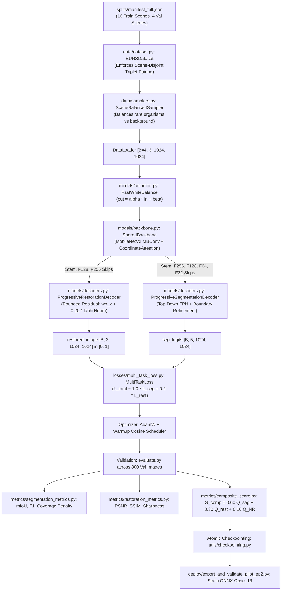

# EURS-Net V2 Repository Inventory & Architecture Dependency Map

**Project:** Embedded Underwater Restoration & Segmentation (EURS @ MaCVi WACV 2027)  
**Track:** Track 2 (Embedded Target: Jetson AGX Orin)  
**Host Environment:** Windows 11, NVIDIA RTX 5090 (PyTorch 2.11.0+cu128)  
**Audit Date:** 2026-10-10  

---

## 1. Directory Structure and Component Mapping

```
c:/Projects/SAT-EURS/
├── configs/
│   └── baseline_v1.yaml            # Authoritative baseline experiment configuration
├── data/
│   ├── cached_1024/                # 1024x1024 pre-cached paired underwater images
│   ├── dataset.py                  # EURSDataset (strict scene-disjoint pairing & contracts)
│   ├── samplers.py                 # SceneBalancedSampler & StandardSampler
│   └── transforms.py               # SynchronizedTransform (100% geometric synchrony)
├── models/
│   ├── common.py                   # FastWhiteBalance (FWB) & CoordinateAttention (CA)
│   ├── backbone.py                 # SharedBackbone (MobileNetV2 MBConv + CoordinateAttention)
│   ├── decoders.py                 # ProgressiveRestorationDecoder & ProgressiveSegmentationDecoder
│   └── eurs_net_v2.py              # EURSNetV2 unified dual-task model
├── losses/
│   ├── msssim.py                   # Differentiable Multi-Scale SSIM loss
│   ├── restoration_loss.py         # Charbonnier, ColorAngle, Laplacian, & RestorationLoss
│   ├── multi_task_loss.py          # Unified MultiTaskLoss (Focal, SoftDice, & Restoration)
│   └── loss_config.py              # Class weighting & authoritative criterion factory
├── metrics/
│   ├── segmentation_metrics.py     # 5x5 confusion matrix, per-class IoU/F1, soft coverage penalty
│   ├── restoration_metrics.py      # PSNR, PSNR_norm (15-35 dB), SSIM (Gaussian), Sharpness Ratio
│   ├── nr_metric.py                # Provisional Non-Reference Quality surrogate stub
│   ├── composite_score.py          # Track 2 Composite score (0.60 Seg + 0.30 Rest + 0.10 NR)
│   └── official_spec.md            # Authoritative metric contract documentation
├── deploy/
│   ├── check_flops.py              # Complexity & parameter budget verifier
│   ├── export_onnx.py              # Baseline ONNX exporter (opset 18 static contract)
│   ├── export_and_validate_pilot_ep2.py # Isolated Pilot Epoch 2 exporter & numerical parity validator
│   ├── benchmark_orin.sh           # Reproducible trtexec benchmark shell script for Orin
│   ├── benchmark_orin_procedure.md # AGX Orin deployment procedure documentation
│   └── exports/pilot_epoch_2/      # Isolated ONNX model (eurs_net_v2_pilot_ep2.onnx)
├── checkpoints/
│   ├── run2_50ep/best_model.pt     # Authoritative 50-epoch baseline checkpoint (Ep 15 best seg)
│   └── forensic_backup/            # Bitwise invariant backup checkpoints
├── experiments/
│   └── exp_pilot_restricted_restoration/ # Restricted pilot checkpoints (Ep 1, Ep 2, Ep 3)
├── audits/
│   ├── final_independent_pilot_audit/    # Verified pilot audit results and parity JSONs
│   ├── diagnostics/                      # fish12 forensic clipping analysis
│   └── pretraining_review/               # Current pre-training audit review and gates
├── splits/
│   └── manifest_full.json          # Frozen persistent scene-disjoint manifest (16 train, 4 val)
├── tools/
│   ├── verify_pilot_audit.py       # Full independent 800-image evaluation audit
│   ├── run_pretraining_gates.py    # 6-gate pre-training verification runner
│   ├── diagnose_fish12_clipping.py # fish12 forensic diagnosis runner
│   └── make_submission.py          # Track 1 & Track 2 packaging utility
└── train.py                        # Unified training entry point
```

---

## 2. End-to-End Execution Dependency Map



---

## 3. Discrepancies Identified During Audit

1. **`best_pilot_checkpoint.pt` vs. Epoch 2:**
   - In `experiments/exp_pilot_restricted_restoration/`, `best_pilot_checkpoint.pt` holds `epoch: 3` and is bitwise identical in model parameters to Pilot Epoch 3, **not Epoch 2**. The filename is misleading because Epoch 3 scored higher on the local surrogate composite score ($0.2050$ vs $0.2038$) despite having degraded PSNR and severe $10.45\%$ clipping on scene `fish12`. Epoch 2 is the mathematically superior model.
2. **Loss Weighting in `train.py` vs. YAML / Factory:**
   - In `configs/baseline_v1.yaml` and `losses/loss_config.py`, the default restoration weight is $0.20$ (`weight_rest: 0.2`).
   - However, in `train.py` line 163, `create_authoritative_criterion` was called with `weight_rest=0.5` without overriding from the YAML config. Any future controlled experiment must explicitly bind this parameter to config control.
3. **Non-Reference Quality Metric Status:**
   - The competition's official $Q_{\text{NR}}$ metric (UIQM/UCIQE/NIQE group) is **not available locally**.
   - `metrics/nr_metric.py` is a local standard deviation contrast surrogate. It must never be presented as the official competition metric.
