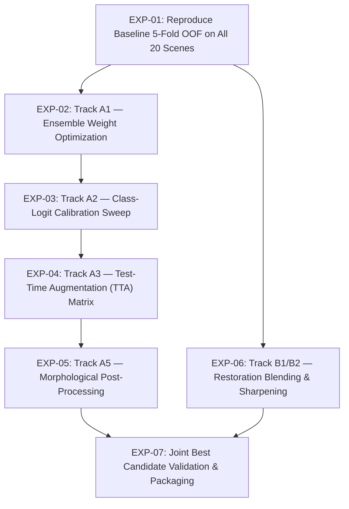

# SAT-EURS Track 1 — Overnight Experimentation Plan

**Campaign ID:** `overnight_20261024`  
**Hardware:** NVIDIA GeForce RTX 5090 (32 GB VRAM)  
**Goal:** Maximize Official Composite Score $S = 0.60 \times Q_{\text{seg}} + 0.30 \times Q_{\text{FR}} + 0.10 \times Q_{\text{NR}}$  

---

## 1. Experiment Schedule & Phasing

---

## 2. Detailed Experiment Specifications

### EXP-01: Reproduce Baseline 5-Fold OOF on All 20 Scenes
- **Objective:** Establish the unassailable held-out baseline on all 20 scenes (800 image variants, stride 5) under the unified evaluator.
- **Hypothesis:** Re-verifies exact baseline $Q_{\text{seg}}$, mIoU, F1, and per-class IoU for the 5-fold ensemble with targeted Fold 0.
- **Acceptance Criterion:** Produces clean reference metrics matching known baseline records.

### EXP-02: Track A1 — Ensemble Weight Optimization
- **Objective:** Test whether weighting the targeted Fold 0 model higher (e.g. $w_0 \in [0.20, 0.40]$) improves held-out $Q_{\text{seg}}$.
- **Hypothesis:** Fold 0 was trained with small-object zoom jitter and small-fauna sampling, boosting fish recall; increasing its ensemble weight may improve macro F1 without harming other folds.
- **Acceptance Criterion:** $\Delta Q_{\text{seg}} \ge +0.003$ on held-out scenes without class regressions.

### EXP-03: Track A2 — Class-Logit Calibration Sweep
- **Objective:** Systematically sweep class logit offsets $[\delta_0, \delta_1, \delta_2, \delta_3, \delta_4]$ on held-out predictions.
- **Hypothesis:** The current heuristic offset $[0.0, 0.0, 0.0, 0.10, 0.25]$ can be tuned on held-out validation to balance precision and recall on Fish and MacroFauna.
- **Acceptance Criterion:** $\Delta Q_{\text{seg}} \ge +0.003$ on pooled held-out validation.

### EXP-04: Track A3 — Test-Time Augmentation (TTA) Matrix
- **Objective:** Measure exact speed and score trade-offs of No-TTA vs Horizontal-Flip TTA vs Multi-Scale TTA.
- **Hypothesis:** Horizontal flip preserves spatial alignment while multi-scale TTA might over-smooth boundaries or increase runtime without commensurate IoU gain.
- **Acceptance Criterion:** Empirically justify the optimal TTA setting for test inference.

### EXP-05: Track A5 — Morphological & Connected-Component Post-Processing
- **Objective:** Test minimum-area filtering for isolated noise speckles on rare classes.
- **Hypothesis:** Suppressing 1-4 pixel disconnected islands can improve background precision if true small fish are preserved.
- **Acceptance Criterion:** $\Delta Q_{\text{seg}} > 0.000$ without deleting true positive fish instances.

### EXP-06: Track B1/B2 — Restoration Blending & Sharpening
- **Objective:** Measure whether blending neural refiner output with raw degraded input $\hat{I} = (1 - \lambda) I_{\text{refiner}} + \lambda I_{\text{raw}}$ or tuning unsharp masking $(\alpha, \sigma)$ improves PSNR and SSIM.
- **Hypothesis:** A conservative blend or edge-preserving sharpening can prevent high-frequency noise amplification and improve $Q_{\text{FR}}$.
- **Acceptance Criterion:** $\Delta Q_{\text{FR}} \ge +0.005$ (+0.0015 composite contribution) on held-out scenes.

### EXP-07: Joint Best Candidate Validation & Packaging
- **Objective:** Combine all validated improvements, execute inference on official 1,200 testing inputs, package into `deploy/overnight_candidate/`, and verify all 8 submission gates.
- **Hypothesis:** Combined improvements lift the official candidate above the 0.634 baseline.
- **Acceptance Criterion:** All 8 submission gates passed 100%, SHA-256 computed, manifest created.
