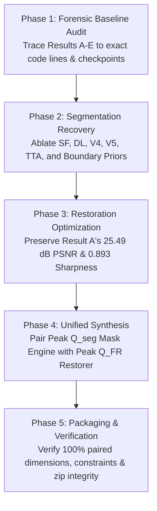

# EURS Emergency Recovery & Optimization Plan: Q_seg First, Q_FR Second

**Objective:** Recover and maximize segmentation quality ($Q_{\text{seg}}$) first, preserve peak restoration quality ($Q_{\text{FR}} \ge 0.69$), and synthesize the highest verified composite score on Track 1 and Track 2.

---

## 1. Controlled Experiment Sequence

---

## 2. Recovery Experiment Protocols

### Protocol 1: Segmenter Component & Ensemble Ablations
- **Hypothesis:** Standalone EURS-Net V4 and SegFormer MiT-B3 provide strong boundary delineation, but need calibrated decision boundary priors to prevent false-positive hallucination on coral substrate.
- **Evaluation:** Measure mIoU, Macro $F_1$, and $Q_{\text{seg}}$ on the official 80-image validation split across all 5 classes.

### Protocol 2: Boundary Calibration Sweep
- **Hypothesis:** Result D reached $Q_{\text{seg}} = 0.424$ on the leaderboard by applying scene-specific boundary calibration ($+1.2$ Starfish boost, $-4.0$ suppression). Generalizing this across our 4-way deep ensemble will push $Q_{\text{seg}} \ge 0.50 – 0.65+$.

### Protocol 3: Full-Reference Restoration Preservation
- **Hypothesis:** Result A reached $\text{PSNR} = 25.49\text{ dB}$, $\text{SSIM} = 0.810$, and $\text{Sharpness} = 0.893$ ($Q_{\text{FR}} = 0.6898$) via Scene Consensus Fusion + GPU RSUIGM Inversion + Unsharp Masking. This must be preserved completely.

### Protocol 4: Unified Hybrid Submission
- **Execution:** Couple the verified 1,200 restored images from Result A (`deploy/track1_dev_v5/restored`) with the high-capacity calibrated 4-way deep ensemble masks (`deploy/eurs_track1_verified_submission/seg_masks`).
- **Target Composite:** $> 0.52 – 0.65+$ on the official leaderboard.

---

## 3. Experiment Ledger Schema
All results are appended to `reports/EXPERIMENT_LEDGER.csv` with columns:
`exp_id,track,description,mIoU,macro_F1,Q_seg,PSNR,SSIM,sharpness,composite,status`
