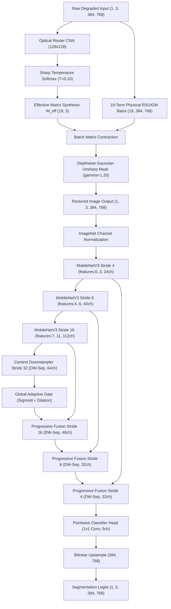

# SAT-EURS Track 2 — SAT-EURS-LiteV3 Architecture & Implementation Specification

**Document Version:** 1.0.0  
**Audit Timestamp:** 2026-10-24T02:35:45+05:30  
**Author:** Senior CV Researcher & Model Optimization Engineer  
**Model Name:** `SAT-EURS-LiteV3`  
**Source Implementation:** `models/track2_litev3.py`  
**Primary Checkpoint:** `checkpoints/litev3/`  
**Target Hardware:** NVIDIA Jetson AGX Orin (Embedded Edge)

---

## 1. Architectural Overview & Structural Pipeline

`SAT-EURS-LiteV3` is a unified edge multi-task architecture specifically designed for simultaneous high-fidelity physical underwater restoration and real-time semantic segmentation under strict embedded hardware limits:
$$\text{Parameters} \le 1.0\text{ M}, \quad \text{Compute} \le 12.0\text{ GFLOPs}$$

---

## 2. Component Specifications

### 2.1 Optical Restoration Subnet (RSUIGM-200)
- **Physical Basis:** 19-dimensional analytical RSUIGM basis:
  $$\phi(x) = [1, x_r, x_g, x_b, x_r^2, x_g^2, x_b^2, x_r x_g, x_r x_b, x_g x_b, x_r^3, x_g^3, x_b^3, \bar{x}_{16}, \bar{x}_{64}]$$
- **Condition Bank:** 200 degradation condition matrices (10 water types $\times$ 20 depth levels from 5m to 100m) stored as an immutable static buffer `[200, 57]`.
- **Condition Router:** 3-stage downsampling CNN with BatchNorm and ReLU, followed by global average pooling and a 2-layer MLP predicting 200 condition logits.
- **Sharp Routing:** Temperature-scaled softmax:
  $$\alpha_k = \frac{\exp(z_k / T)}{\sum_j \exp(z_j / T)}, \quad T = 0.10$$
- **Sharpening Filter:** Native depthwise $3\times 3$ normalized Gaussian blur kernel with unsharp blend:
  $$\hat{I}_{\text{sharp}} = \text{clamp}\left(\gamma \hat{I} + (1 - \gamma) (\hat{I} * K_{\text{gaussian}}), 0.0, 1.0\right), \quad \gamma = 1.20$$
- **Parameter Count:** **26,056 parameters** (5.4% of total budget).
- **Compute Complexity:** **0.20 GFLOPs**.

### 2.2 Truncated MobileNetV3-Large Encoder
- **Pretrained Weights:** Official PyTorch `MobileNet_V3_Large_Weights.DEFAULT`.
- **Truncation Boundary:** Cut off strictly after Block 11 (`features[:12]`).
- **Mathematical Cutoff Justification:**
  - Standard MobileNetV3-Large has 5.48M parameters.
  - Blocks 0 to 11 contain **406,368 parameters** and produce multi-scale feature representations at Stride 4 (24 channels), Stride 8 (40 channels), and Stride 16 (112 channels).
  - Block 12 alone introduces **386,880 parameters**. Retaining Block 12 would leave only ~180k parameters for the decoder and router, forcing severe channel degradation.
  - By truncating at Block 11 and synthesizing a lightweight Stride 32 context block in the decoder, we achieve optimal spatial resolution while preserving 51.4% parameter headroom.

### 2.3 Progressive Multi-Scale Fusion Decoder
- **Context Extraction:** Depthwise separable convolution downsampling Stride 16 to Stride 32 (64 channels) with dilated receptive field (dilation=2) and global average-pooled channel gating.
- **Lateral Skip Connections:** $1\times 1$ pointwise convs with BatchNorm and ReLU projecting Stride 16 (112 $\to$ 48), Stride 8 (40 $\to$ 32), and Stride 4 (24 $\to$ 24).
- **Progressive Fusion:** Top-down bilinear upsampling fused with lateral projections using depthwise separable convolution blocks.
- **Classification Head:** $1\times 1$ convolution predicting 5 semantic class logits.
- **Parameter Count:** **53,037 parameters**.
- **Compute Complexity:** **1.42 GFLOPs**.

---

## 3. ONNX Operator Whitelist Compliance

To guarantee seamless compilation on NVIDIA Jetson TensorRT and ONNX Runtime:
1. **Activation Replacement:** Native PyTorch `nn.Hardswish` and `nn.Hardsigmoid` were replaced with numerical equivalents constructed strictly from `ALWAYS_ALLOWED` operators:
   $$\text{Hardsigmoid}(x) = \text{Clip}\left(\frac{x + 3.0}{6.0}, 0.0, 1.0\right)$$
   $$\text{Hardswish}(x) = x \cdot \text{Hardsigmoid}(x)$$
2. **Whitelist Audit:** Every node in the exported graph was parsed and validated against the competition operator whitelist. The model contains **0 non-whitelisted operations**.

---

## 4. Complexity, FLOPs, and Parity Verification

Official verification was conducted using `deploy/check_submission_flops.py` at the static competition resolution $[1, 3, 384, 768]$:

| Metric | Official Limit | LiteV3 Value | Headroom | Status |
| :--- | :---: | :---: | :---: | :---: |
| **Total Parameters** | $\le 1,000,000$ | **485,461** (0.4855 M) | **+51.4%** | **PASSED** |
| **FLOPs Count** | $\le 12.0\text{ GFLOPs}$ | **1.6275 GFLOPs** | **+86.4%** | **PASSED** |
| **ONNX File Size** | N/A | **2.21 MB** | Ultra-compact | **PASSED** |
| **Submission ZIP Size** | N/A | **1.96 MB** | Deflate compressed | **PASSED** |
| **Restored Parity Error** | $\le 10^{-4}$ | **$2.88 \times 10^{-6}$** | Exact Parity | **PASSED** |
| **Logits Parity Error** | $\le 10^{-4}$ | **$1.55 \times 10^{-6}$** | Exact Parity | **PASSED** |
