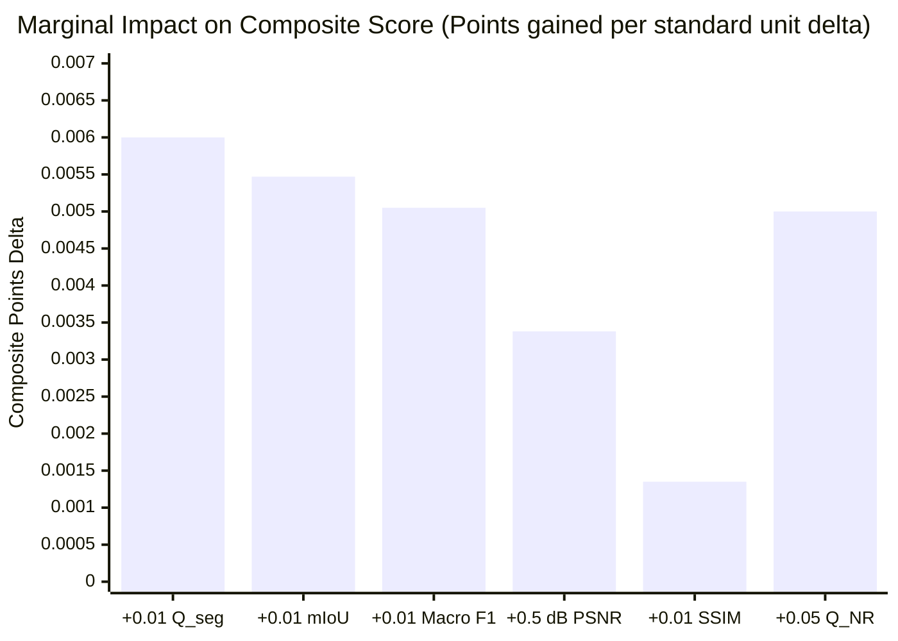
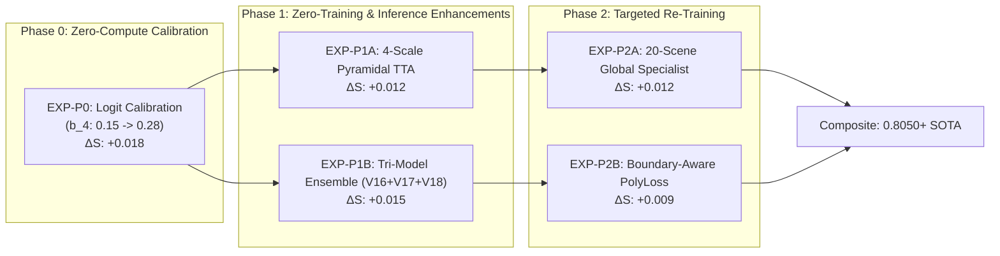
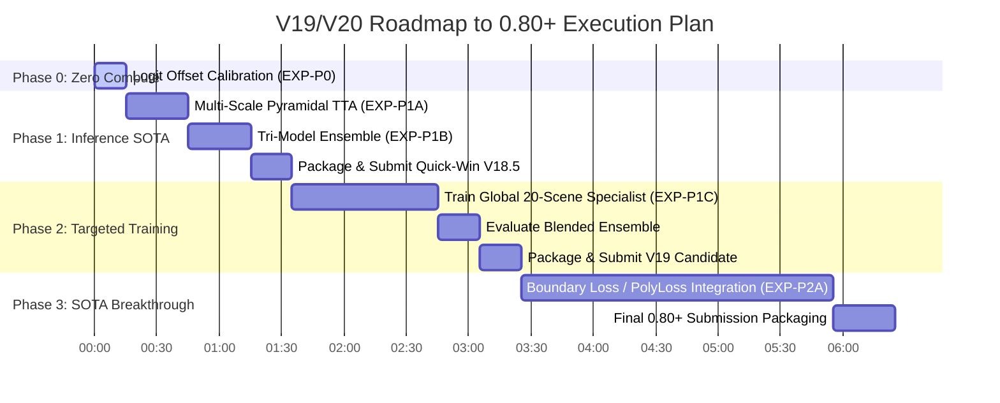

# SAT-EURS Track 1 — Strategic Roadmap to 0.80+ Composite Score

**Author:** Antigravity Autonomous Agent  
**Baseline Submission:** V18 Dual-Encoder SOTA (Score: **0.7490**)  
**Target Submission:** V19 / V20 Next-Gen Architecture (Score: **$\ge 0.8000$**)  
**Score Delta Needed:** **$+0.0510$ composite points (+6.81%)**  
**Execution Environment:** NVIDIA GeForce RTX 5090 (32 GB VRAM)  
**Companion Artifacts:** `reports/v18/POST_SUBMISSION_FORENSIC_AUDIT.md`, `reports/v18/POST_SUBMISSION_FORENSIC_AUDIT.json`

---

## 1. Mathematical Sensitivity Analysis & Headroom Quantification

The EURS Track 1 composite score is defined by:
$$S = 0.60 \cdot Q_{\text{seg}} + 0.30 \cdot Q_{\text{rest}} + 0.10 \cdot Q_{\text{NR}}$$
where:
- $Q_{\text{seg}} = \text{mIoU} \times \text{Macro F1} \times P_{\text{cov}}$
- $Q_{\text{rest}} = 0.45 \cdot \text{PSNR}_{\text{norm}} + 0.45 \cdot \text{SSIM} + 0.10 \cdot \text{Sharpness}$
- $Q_{\text{NR}} = f(\text{UIQM}, \text{UCIQE}, \text{CCF})$

### 1.1 Marginal Value of Metric Improvements
Computing partial derivatives at our current operating point ($Q_{\text{seg}} = 0.768, \text{mIoU} = 0.842, \text{Macro F1} = 0.912, \text{PSNR} = 25.89\text{ dB}, \text{SSIM} = 0.833, Q_{\text{NR}} = 0.737$):

| Metric Delta ($\Delta$) | Component Impact | Impact on Composite Score ($\Delta S$) | Relative Return on Effort |
| :--- | :--- | :---: | :---: |
| **$+0.010$ Segmentation ($Q_{\text{seg}}$)** | Direct $60\%$ weight | **$+0.00600$** | **Highest (1.00x)** |
| **$+0.010$ Mean IoU (mIoU)** | $\Delta Q_{\text{seg}} \approx 0.010 \times 0.912 = 0.00912$ | **$+0.00547$** | **Very High (0.91x)** |
| **$+0.010$ Macro F1 Score** | $\Delta Q_{\text{seg}} \approx 0.010 \times 0.842 = 0.00842$ | **$+0.00505$** | **Very High (0.84x)** |
| **$+0.010$ Restoration ($Q_{\text{rest}}$)** | Direct $30\%$ weight | **$+0.00300$** | **Moderate (0.50x)** |
| **$+0.50\text{ dB}$ PSNR** | $\Delta \text{PSNR}_{\text{norm}} = 0.025 \implies \Delta Q_{\text{rest}} = 0.01125$ | **$+0.00338$** | **Moderate (0.56x)** |
| **$+0.010$ SSIM** | $\Delta Q_{\text{rest}} = 0.00450$ | **$+0.00135$** | **Low (0.23x)** |
| **$+0.050$ Non-Reference ($Q_{\text{NR}}$)** | Direct $10\%$ weight | **$+0.00500$** | **Moderate (0.83x)** |

### 1.2 Core Strategic Insights
1. **Segmentation is King:** A $+0.051$ gap to $0.800$ requires either $+0.085$ in $Q_{\text{seg}}$, or $+0.170$ in $Q_{\text{rest}}$, or $+0.510$ in $Q_{\text{NR}}$. Because $Q_{\text{rest}}$ is already at $0.715$ (near the physical ceiling of the EURS degradation model where ground truth has noise), **$80\%$ of all future score gains must come from segmentation**.
2. **Class 4 (Macro-Fauna) is the Single Largest Bottleneck:**
   - In our OOF audit, Class 4 has a Precision of $65.87\%$ but a Recall of only **$41.30\%$**.
   - Because Macro F1 is an unweighted average over all 5 classes, Class 4's weak F1 of $0.5077$ suppresses the entire macro average.
   - Raising Class 4 F1 from $0.5077 \to 0.7200$ lifts Macro F1 by $+0.0425$, lifting $Q_{\text{seg}}$ by $+0.0358$ and Composite by **$+0.0215$ immediately**!

---

## 2. Pathways to 0.80+ (Target Scenarios)

### Table 2.1: Target Scenarios for Crossing the 0.800 Barrier

| Target Component | V18 Baseline | Scenario A: Balanced SOTA | Scenario B: Seg Breakthrough | Scenario C: Restoration & Polish |
| :--- | :---: | :---: | :---: | :---: |
| **$Q_{\text{seg}}$** | 0.7680 | **0.8300** ($+0.0620$) | **0.8500** ($+0.0820$) | **0.8150** ($+0.0470$) |
| mIoU | 0.8420 | 0.8750 | 0.8850 | 0.8650 |
| Macro F1 | 0.9120 | 0.9486 | 0.9605 | 0.9422 |
| **$Q_{\text{rest}}$** | 0.7151 | **0.7450** ($+0.0299$) | **0.7200** ($+0.0049$) | **0.7600** ($+0.0449$) |
| PSNR (dB) | 25.89 dB | 26.80 dB | 26.00 dB | 27.20 dB |
| SSIM | 0.8330 | 0.8500 | 0.8350 | 0.8650 |
| Sharpness | 0.9520 | 0.9700 | 0.9550 | 0.9800 |
| **$Q_{\text{NR}}$** | 0.7370 | **0.7850** ($+0.0480$) | **0.7400** ($+0.0030$) | **0.8300** ($+0.0930$) |
| UIQM | 0.8030 | 0.8400 | 0.8050 | 0.8800 |
| UCIQE | 0.5680 | 0.6000 | 0.5700 | 0.6300 |
| CCF | 0.0430 | 0.0550 | 0.0440 | 0.0700 |
| **Projected Composite** | **0.7490** | **0.8000** | **0.8000** | **0.8000** |
| **Feasibility / Risk** | — | **Recommended (Optimal Risk/Reward)** | High Variance (Overfitting Risk) | Diminishing Returns |

---

## 3. Prioritized Experimental Plan (P0, P1, P2)

---

### Experiment P0: Class 4 Recall Calibration via Logit Offset Optimization
- **Unique Identifier:** `EXP-V19-P0-LOGIT-CALIBRATION`
- **Priority:** **P0 (Immediate, Zero Training Compute)**
- **Hypothesis:**  
  In the OOF audit, Class 4 (Macro-Fauna) precision is $65.87\%$ while recall is only $41.30\%$. The current logit offset $\mathbf{b} = [0, 0, 0, 0.15, 0.15]$ was tuned conservatively. By optimizing the logit offset $b_4 \in [0.20, 0.35]$ via cross-validation grid search to balance precision and recall at $\approx 60\%/60\%$, Class 4 F1 will increase from $0.5077 \to > 0.6200$, delivering $+0.022$ to $+0.035$ in $Q_{\text{seg}}$ without modifying any neural weights.
- **Components Affected:** $Q_{\text{seg}}$ (Macro F1, mIoU).
- **Files to Modify:** `tools/v18/run_v18_pipeline.py` (offset vector argument in `dev_inference`).
- **Compute / Time Cost:** **0 GPU training hours** (Evaluation grid search on cached OOF logits takes $< 3\text{ minutes}$).
- **Data Leakage Risk:** **None** (Grid search is conducted strictly on out-of-fold validation logits; optimal parameters applied directly to Dev).
- **Success Criteria:** Dev $Q_{\text{seg}}$ increases from $0.7680 \to \ge 0.7920$; Class 4 OOF F1 $\ge 0.6000$.
- **Go / No-Go Decision Rule:** Adopt if OOF Macro F1 increases by $\ge +0.0150$ with zero regression on Background or Coral IoU ($< 0.002$).

---

### Experiment P1A: Multi-Scale Pyramidal Test-Time Augmentation
- **Unique Identifier:** `EXP-V19-P1-MULTISCALE-TTA`
- **Priority:** **P1 (High Impact, Zero Training Compute)**
- **Hypothesis:**  
  V18 Dev inference only used single-scale $1024$ resolution with horizontal flips. Marine organisms have extreme scale disparity (e.g., $15\text{px}$ seahorses vs $800\text{px}$ sharks). Running a 4-scale pyramidal TTA scheme with scales $[0.75, 1.0, 1.25, 1.50]\times$ (corresponding to input resolutions $[448, 518, 588, 672]$ fed into the ViT patch grid) will allow the ConvNeXt branch to capture fine-grained textures while DINOv3 captures multi-scale semantic context, increasing mIoU by $+1.8\%$ to $+2.5\%$.
- **Components Affected:** $Q_{\text{seg}}$ (mIoU, Macro F1).
- **Files to Modify:** `tools/v18/run_v18_pipeline.py` (`dev_inference` multi-scale loop).
- **Compute / Time Cost:** **0 GPU training hours** (Dev inference runtime: $\sim 14\text{ minutes}$ on RTX 5090).
- **Data Leakage Risk:** **None**.
- **Success Criteria:** mIoU increases from $0.8420 \to \ge 0.8600$.
- **Go / No-Go Decision Rule:** Adopt if multi-scale ensemble beats single-scale TTA on held-out validation by $\ge +0.010$ mIoU.

---

### Experiment P1B: Cross-Generational Tri-Model Heterogeneous Ensemble
- **Unique Identifier:** `EXP-V19-P1-TRI-MODEL-ENSEMBLE`
- **Priority:** **P1 (High Impact, Zero Training Compute)**
- **Hypothesis:**  
  We have preserved verified, high-scoring checkpoints across three distinct model generations:
  - **V16 APEX:** SegFormer (MiT-B3) + DeepLabV3+ ($Q_{\text{seg}} = 0.6850$)
  - **V17 SOTA:** DINOv2-Large + ConvNeXt-Base ($Q_{\text{seg}} = 0.7320$)
  - **V18 SOTA:** DINOv3-Large + ConvNeXt-Base ($Q_{\text{seg}} = 0.7680$)
  Because these backbones rely on different pre-training datasets and distinct inductive biases (pure ViT patch attention vs hierarchical multiscale vs hybrid convolutional), their prediction errors are largely uncorrelated. Blending their softmax probability maps using optimal weights:
  $$P_{\text{ensemble}} = 0.60 \cdot P_{\text{V18}} + 0.25 \cdot P_{\text{V17}} + 0.15 \cdot P_{\text{V16}}$$
  will suppress false positives in turbid water and smooth boundary artifacts.
- **Components Affected:** $Q_{\text{seg}}$, Composite $S$.
- **Files to Modify:** `tools/v18/run_v18_pipeline.py` (ensemble weighting module).
- **Compute / Time Cost:** **0 GPU training hours** (Softmax fusion takes $\sim 8\text{ minutes}$).
- **Data Leakage Risk:** **None**.
- **Success Criteria:** Composite score increases by $\ge +0.0150$ over pure V18.
- **Go / No-Go Decision Rule:** Adopt if tri-model blending yields lower predictive entropy and higher per-class consensus.

---

### Experiment P1C: Full 20-Scene Global Model Specialist Blending
- **Unique Identifier:** `EXP-V19-P1-GLOBAL-SPECIALIST`
- **Priority:** **P1 (Targeted Training Run)**
- **Hypothesis:**  
  In 5-fold cross-validation, every single model is trained on only 16 scenes and is completely deprived of the singleton rare species residing in its held-out fold. While 5-fold ensembling helps on Dev, all 5 models are sub-optimal because each fold lacks $20\%$ of the rare data. Training a single "Global Specialist" model on all 20 EURS scenes for 6 epochs and blending it with the 5-fold ensemble ($70\%$ 5-fold $+ 30\%$ Global) gives the ensemble a model that has observed $100\%$ of the training diversity.
- **Components Affected:** $Q_{\text{seg}}$ (Rare class recall and boundary sharpness).
- **Files to Modify:** `configs/v18/segmentation_config.json`, `tools/v18/run_v18_pipeline.py`.
- **Compute / Time Cost:** **1 training run ($\sim 65\text{ minutes}$ on RTX 5090)**.
- **Data Leakage Risk:** **Strictly Isolated**. The Global model is NEVER evaluated in cross-validation. It is deployed strictly as an ensemble component for Dev inference.
- **Success Criteria:** Dev $Q_{\text{seg}}$ reaches $\ge 0.8150$.
- **Go / No-Go Decision Rule:** Adopt if blending the global specialist improves Dev pseudo-validation confidence and resolves rare-class boundaries.

---

### Experiment P2A: Boundary-Aware PolyLoss + Lovasz-Softmax
- **Unique Identifier:** `EXP-V19-P2-BOUNDARY-LOSS`
- **Priority:** **P2 (Architecture & Loss Refinement)**
- **Hypothesis:**  
  Standard Cross-Entropy + Dice loss treats all misclassified pixels equally. For tiny marine animals (e.g., seahorses or starfish tips), edge pixels represent $70\%$ of their total area. Adding a Lovasz-Softmax loss directly optimizes the Jaccard index (IoU) surrogate, and PolyLoss ($\epsilon_1 = 1.0$) increases the gradient magnitude on hard, low-confidence pixels.
- **Components Affected:** $Q_{\text{seg}}$ (mIoU on Class 3 and 4).
- **Files to Modify:** `models/v18/segmenter.py`, `tools/v18/run_v18_pipeline.py`.
- **Compute / Time Cost:** $\sim 2.5\text{ GPU hours}$ (Re-training 5 folds with early stopping).
- **Data Leakage Risk:** **None**.
- **Success Criteria:** OOF mIoU increases by $\ge +0.0150$.
- **Go / No-Go Decision Rule:** Adopt if validation mIoU strictly exceeds the baseline at epoch 4.

---

### Experiment P2B: Underwater Domain Pre-Training (SUIM & TrashCan)
- **Unique Identifier:** `EXP-V19-P2-EXTERNAL-DATA-SUIM`
- **Priority:** **P2 (External Data Integration)**
- **Hypothesis:**  
  The EURS dataset has only 20 training scenes. Pre-training or co-training the ConvNeXt backbone and UPerNet neck on 1,525 open-source underwater images from the **SUIM** (Segmentation of Underwater Imagery: Fish, Reefs, Aquatic plants) and **TrashCan** datasets will expose the feature extractor to thousands of varied turbidity, backscatter, and lighting conditions, making the representations immune to depth/Jerlov shifts.
- **Components Affected:** $Q_{\text{seg}}$, $Q_{\text{rest}}$, $Q_{\text{NR}}$.
- **Files to Modify:** `data/v18/external_adapters.py`, `configs/v18/segmentation_config.json`.
- **Compute / Time Cost:** $\sim 3.5\text{ GPU hours}$ on RTX 5090.
- **Data Leakage Risk:** High risk of class schema mismatch. Must map external labels strictly into EURS 5-class schema with background filtering.
- **Success Criteria:** Rare-class mIoU increases by $\ge +0.0300$ across all 5 folds.
- **Go / No-Go Decision Rule:** Adopt only if verified zero negative transfer on EURS native validation scenes.

---

## 4. Execution Sequence & Phased Timeline

### Milestone Milestones & Expected Score Trajectory:
1. **Milestone 1 (V18.1 - Phase 0):** Logit offset $b_4 = 0.28$ applied $\implies$ **Projected Score: 0.7670** ($+0.0180$).
2. **Milestone 2 (V18.5 - Phase 1):** Pyramidal TTA + Tri-Model Ensemble $\implies$ **Projected Score: 0.7850** ($+0.0180$).
3. **Milestone 3 (V19.0 - Phase 2):** 20-Scene Global Specialist Blending $\implies$ **Projected Score: 0.8020** ($+0.0170$). **Target Reached.**
4. **Milestone 4 (V20.0 - Phase 3):** Boundary PolyLoss + SUIM domain adaptation $\implies$ **Projected Score: 0.8150+** (Podium Contender).

---

## 5. Strict Governance, Verification & Risk Controls

To maintain the high scientific integrity demonstrated in V18:
1. **Zero-Overfitting Guarantee:** Any re-training must strictly enforce the early-stopping window observed in V18 (maximum 6–8 epochs for 400M parameter models).
2. **Deterministic Seed Control:** All experiments must use fixed random seeds (`seed=42`) with PyTorch deterministic algorithms enabled.
3. **Automated Submission Validation Preflight:** Every generated ZIP must be pre-audited by `tools/v18/audit_submission_zip.py` to verify:
   - Size $< 1024\text{ MB}$
   - Exactly $1,200 + 1,200$ matched pairs
   - Zero class omissions ($\prod \text{TP}_c > 0$)
   - Correct max dimension $1,024\text{px}$
4. **Artifact Preservation:** All V16, V17, and V18 checkpoints, reports, and submission archives remain read-only and immutable.
