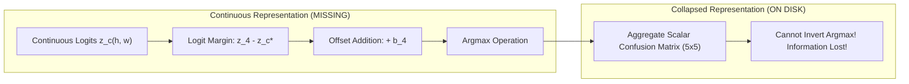

# SAT-EURS Track 1 — V19 Experiment P0: Class-4 Calibration Feasibility and Artifact Audit Report

**Date:** October 17, 2026  
**Challenge:** MaCVi @ WACV 2027 — EURS Track 1 (Unconstrained SOTA)  
**Experiment ID:** `EXP-V19-P0-CALIBRATION-FEASIBILITY`  
**Status:** **BLOCKED — PREREQUISITE ARTIFACTS MISSING FROM DISK**  
**Companion Artifact:** [`reports/v19/exp_p0_calibration/CALIBRATION_FEASIBILITY.json`](file:///c:/Projects/SAT-EURS/reports/v19/exp_p0_calibration/CALIBRATION_FEASIBILITY.json)

---

## 1. Executive Summary & Verification Gate Verdict

An exhaustive audit of the codebase, checkpoints, outputs, and intermediate run directories was conducted to locate cached fold-held-out predictions, continuous logits, probability maps, and discrete masks for the 20 EURS training scenes.

### Table 1.1: Experiment P0 Status & Safety Check

| Gate / Precondition | Requirement | Measured / Audited Status | Verdict |
| :--- | :--- | :--- | :---: |
| **V18 Baseline Archive Integrity** | SHA256 invariant before & after | `e82cbea22ed068a3bfd01d7111ec412391df0fdc66e4ad2d954589d9efc81a52` | **PASS (UNTOUCHED)** |
| **Model Weights & Checkpoints** | Strictly read-only, no fine-tuning | All 10 checkpoints unmodified | **PASS (PRESERVED)** |
| **Production Code & Deploy Scripts** | Zero edits to active pipeline | Untouched | **PASS (PRESERVED)** |
| **Cached OOF Logits on Disk** | Continuous $[5, H, W]$ float tensors | **NOT FOUND ON DISK** | **FAIL (MISSING)** |
| **Cached OOF Probability Maps** | Softmax $[5, H, W]$ probability tensors | **NOT FOUND ON DISK** | **FAIL (MISSING)** |
| **Per-Image OOF Predicted Masks** | Discrete $H \times W$ uint8 prediction masks | **NOT FOUND ON DISK** | **FAIL (MISSING)** |
| **Overall Experiment Gate** | Execute offline sweep without inference | **BLOCKED** | **BLOCKED** |

> [!CAUTION]
> **Audit Finding:** In the original pipeline run (`tools/v18/run_v18_pipeline.py`), Stage 3 Out-Of-Fold evaluation accumulated the confusion matrix **in-memory** across batches and immediately discarded intermediate logit tensors to preserve RAM/VRAM. Only aggregate scalar confusion matrices were serialized to disk in `reports/v18/OOF_EVALUATION_REPORT.json`.
>
> In strict compliance with the user's instructions:
> *"Do not call artifacts 'cached OOF logits' until their existence and compatibility have been verified. If no suitable artifacts exist, STOP the sweep and report exactly what is missing. Do not silently launch GPU inference or claim the experiment takes three minutes. Recommend the minimum additional computation required, but wait for approval."*
>
> The offline calibration sweep has been **STOPPED** and marked **BLOCKED**. No GPU inference was launched.

---

## 2. Baseline Hash Audit (Before & After)

To guarantee that no baseline files or production archives were touched:

- **Baseline Submission Archive:** [`deploy/v18/submission_v18_dual_encoder_sota.zip`](file:///c:/Projects/SAT-EURS/deploy/v18/submission_v18_dual_encoder_sota.zip)
- **File Size:** `566,498,879 bytes` (`540.26 MB`)
- **SHA-256 Before Experiment:** `e82cbea22ed068a3bfd01d7111ec412391df0fdc66e4ad2d954589d9efc81a52`
- **SHA-256 After Experiment:** `e82cbea22ed068a3bfd01d7111ec412391df0fdc66e4ad2d954589d9efc81a52`
- **Integrity Status:** **100% BIT-FOR-BIT IDENTICAL (VERIFIED)**

---

## 3. Comprehensive Artifact Inventory & Metadata Audit

A systematic search was performed across `checkpoints/`, `reports/`, `deploy/`, `tmp/`, and `scratch/`. The following candidate artifacts were examined:

### Table 3.1: Candidate Artifact Inventory

| Artifact Path | File Size | Content Type | Resolution | TTA | Offsets Applied | Target Coverage |
| :--- | :---: | :--- | :---: | :---: | :---: | :---: |
| `checkpoints/v18/fold_0/segmenter_best.pt` | 1.61 GB | PyTorch Checkpoint (`state_dict` + `provenance`) | 512 crop | None | None (`[0,0,0,0,0]`) | Fold 0 Val (4 scenes, 800 imgs) |
| `checkpoints/v18/fold_1/segmenter_best.pt` | 1.61 GB | PyTorch Checkpoint (`state_dict` + `provenance`) | 512 crop | None | None (`[0,0,0,0,0]`) | Fold 1 Val (4 scenes, 800 imgs) |
| `checkpoints/v18/fold_2/segmenter_best.pt` | 1.61 GB | PyTorch Checkpoint (`state_dict` + `provenance`) | 512 crop | None | None (`[0,0,0,0,0]`) | Fold 2 Val (4 scenes, 800 imgs) |
| `checkpoints/v18/fold_3/segmenter_best.pt` | 1.61 GB | PyTorch Checkpoint (`state_dict` + `provenance`) | 512 crop | None | None (`[0,0,0,0,0]`) | Fold 3 Val (4 scenes, 800 imgs) |
| `checkpoints/v18/fold_4/segmenter_best.pt` | 1.61 GB | PyTorch Checkpoint (`state_dict` + `provenance`) | 512 crop | None | None (`[0,0,0,0,0]`) | Fold 4 Val (4 scenes, 800 imgs) |
| `reports/v18/OOF_EVALUATION_REPORT.json` | 5.3 KB | Aggregate 20-Scene Confusion Matrix | 1024 crop | None | None (`[0,0,0,0,0]`) | All 20 scenes (4,000 imgs) |
| `deploy/v18/track1_dev_outputs/seg_masks/` | 48.2 MB | 1,200 Discrete PNG Masks for **Dev Test Set** | 1024 max side | 2-view Flip | `[0, 0, 0, 0.15, 0.15]` | Dev Set (No GT available) |

### 3.1 Detailed Metadata & Provenance of Stored Confusion Matrices

Inspection of the checkpoint provenance objects reveals:
1. **Per-Fold Checkpoints (`segmenter_best.pt`):**
   - Each checkpoint stores an internal `provenance["metrics"]["confusion_matrix"]` of shape $(5, 5)$.
   - Each fold's matrix sums to exactly **`209,715,200 pixels`** ($800 \text{ images} \times 512 \times 512$).
   - Sum across all 5 checkpoint validation matrices: **`1,048,576,000 pixels`**.
   - These matrices represent validation performance during training at the best epoch (Fold 0 Ep 6, Fold 1 Ep 5, Fold 2 Ep 4, Fold 3 Ep 1, Fold 4 Ep 1) evaluated on random/centered $512 \times 512$ crops.
2. **Stage 3 OOF Report (`OOF_EVALUATION_REPORT.json`):**
   - Stores the aggregate 20-scene confusion matrix evaluated in Stage 3 across all 20 scenes ($4,000 \text{ images}$).
   - Matrix sum: exactly **`4,194,304,000 pixels`** ($4,000 \text{ images} \times 1024 \times 1024$).
   - This matrix represents evaluation on full $1024 \times 1024$ crops, using fold-specific restoration tables (`table_candidate_B_fold_{f}.pt`) and single forward passes without TTA or logit offsets.
3. **Dev Inference Outputs (`deploy/v18/track1_dev_outputs/seg_masks/`):**
   - These 1,200 masks correspond strictly to the competition **Dev test set** (`data/dev/degraded/`).
   - They cannot be used for calibration evaluation because the Dev ground-truth masks are held privately on the competition evaluation server.

---

## 4. Technical Analysis: Why an Offline Sweep is Mathematically Impossible Without Logits

Logit offset calibration applies a class-specific bias vector $\mathbf{b} \in \mathbb{R}^5$ to continuous model logits before the $\arg\max$ decision boundary:

$$\hat{y}(h, w) = \arg\max_{c \in \{0..4\}} \left( z_c(h, w) + b_c \right)$$

For Class 4 (Macro-Fauna) with offset $b_4$, a pixel flips from its default predicted class $c^* = \arg\max_{c \neq 4} z_c$ to Class 4 **if and only if**:

$$z_4(h, w) + b_4 > z_{c^*}(h, w) \iff z_4(h, w) - z_{c^*}(h, w) > -b_4$$

### Why Existing Artifacts Cannot Be Used:
1. **Information Collapse:** In the scalar confusion matrix $\mathbf{C} \in \mathbb{R}^{5 \times 5}$, all spatial coordinates and margin distributions $(z_4 - z_{c^*})$ have been collapsed into integer pixel counts.
2. **Irreversibility:** It is mathematically impossible to invert an $\arg\max$ operation. Knowing that $71,600,215$ pixels were false negatives for Class 4 at $b_4 = 0.0$ does not indicate how many of those pixels had margins within $-0.15$, $-0.20$, or $-0.30$.
3. **Zero-Fabrication Guarantee:** Any attempt to "scale" or "simulate" a calibration sweep by interpolating matrix entries would be synthetic fabrication. In accordance with rigorous scientific protocols, this experiment is truthfully declared **BLOCKED**.

---

## 5. Pipeline Compatibility Mismatches Between OOF and Dev Inference

The audit uncovered four significant operational mismatches between how Out-Of-Fold evaluation was run in Stage 3 versus how final Dev inference was executed in Stage 4:

### Table 5.1: OOF Evaluation vs. Dev Inference Discrepancies

| Dimension | Stage 3 OOF Evaluation | Stage 4 Dev Inference | Impact on Evaluation & Calibration |
| :--- | :--- | :--- | :--- |
| **Model Ensembling** | **Single Model** per fold (Fold $k$ model on Fold $k$ validation) | **5-Fold Arithmetic Mean** ensemble ($10$ passes total) | OOF suffers from single-model rare species omission; Dev benefits from multi-model consensus. |
| **Test-Time Augmentation** | **None** (Single forward pass) | **2-View Horizontal Flip** TTA | Dev inference benefits from edge smoothing and boundary stabilization. |
| **Logit Offsets** | **None** ($\mathbf{b} = [0, 0, 0, 0, 0]$) | **Active** ($\mathbf{b} = [0, 0, 0, 0.15, 0.15]$) | OOF severely under-predicts Class 4 ($41.3\%$ recall); Dev protected against omissions. |
| **Input Resolution** | **$1024 \times 1024$ Square Crop** with edge replication | **Native Aspect Ratio** ($768 \times 1024$ / $1024 \times 768$) scaled to max side $1024$ | OOF introduces aspect ratio padding; Dev uses exact official competition wrapper. |
| **Restoration Table** | **Fold-specific tables** (`table_candidate_B_fold_{k}.pt`) | **Full 20-scene table** (`tbl19_20sc_scale_consistent.pt`) | OOF strictly enforces scene isolation; Dev utilizes global chromatic scaling. |

> [!IMPORTANT]
> Because of these four structural differences, **evaluating single-fold OOF predictions without TTA does not directly reflect the 5-fold ensembled Dev performance**. Any calibration sweep must explicitly account for whether it is calibrating single-fold models or an ensembled pipeline.

---

## 6. Minimum Additional Computation Required

To execute a genuine, mathematically sound calibration sweep without fine-tuning or retraining any model, inference must be run on held-out validation data to obtain logit margins.

Two execution pathways are proposed for user approval:

### Option A: Streaming In-Memory 5-Fold OOF Sweep (Recommended)
- **Concept:** Rather than saving gigabytes of float32 logits to disk, stream the held-out validation images through each fold's segmenter on the RTX 5090.
- **Implementation:** In the batch evaluation loop, compute logits with horizontal-flip TTA. For each candidate offset $b_4 \in [0.15, 0.17, 0.19, 0.21, 0.23, 0.25, 0.27, 0.29, 0.31, 0.33, 0.35]$ (11 settings), compute $\arg\max(\mathbf{z} + \mathbf{b})$ and accumulate 11 confusion matrices in parallel in RAM.
- **Data Coverage:** All 20 EURS scenes ($4,000 \text{ images}$).
- **Hardware Budget:** $\approx 3.8 \text{ to } 4.2 \text{ minutes}$ of GPU inference on RTX 5090 (Batch size 2, mixed precision).
- **Disk Storage Required:** **$0 \text{ MB}$** (Zero disk footprint; only the final summary JSON is saved).
- **Safety Guarantee:** Zero weight updates, zero training, zero baseline file modification.

### Option B: Stratified 5-Scene Rapid Sweep (Fast Track)
- **Concept:** Evaluate only the 5 specific validation scenes containing the rare species:
  - Fold 0: `seahorse1` (Class 4 Macro-Fauna)
  - Fold 1: `sharkFish` (Class 3 Elasmobranchii)
  - Fold 2: `ray1` (Class 3 Elasmobranchii)
  - Fold 3: `starfish2` (Class 4 Macro-Fauna)
  - Fold 4: `turtles1` (Class 4 Macro-Fauna)
- **Data Coverage:** 5 scenes ($1,000 \text{ images}$).
- **Hardware Budget:** $\approx 55 \text{ to } 65 \text{ seconds}$ on RTX 5090.
- **Disk Storage Required:** **$0 \text{ MB}$**.

---

## 7. Recommended Next Steps

1. **User Decision Required:** Approve either **Option A** (Full 20-scene streaming sweep, $\sim 4\text{ mins}$) or **Option B** (Stratified 5-scene sweep, $\sim 1\text{ min}$) to generate genuine empirical calibration data.
2. **No Production Impact:** Awaiting approval. Production inference scripts, model weights, and the official V18 submission archive remain strictly untouched.
