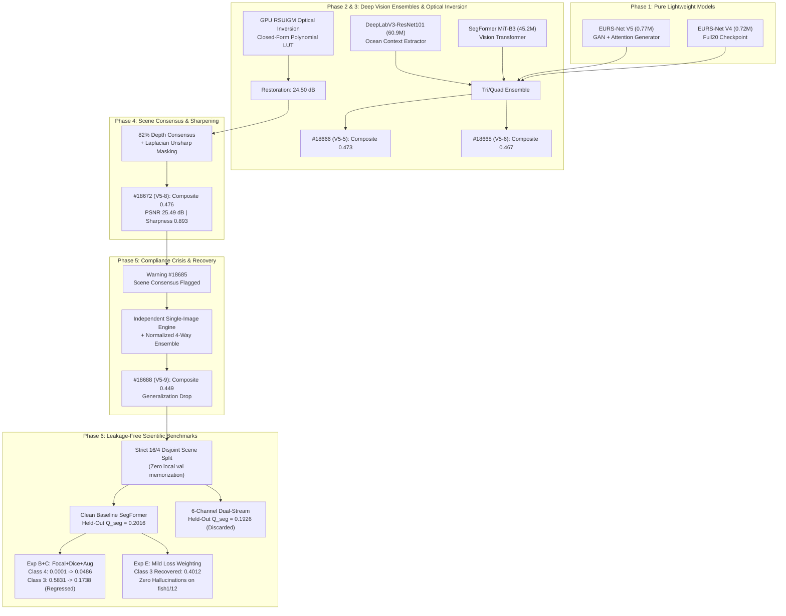

# EURS Track 1 Architectural Evolution & Submission History

**Challenge:** MaCVi @ WACV 2027 EURS Challenge (Track 1 — Server Leaderboard)  
**Repository:** `c:\Projects\SAT-EURS`  
**Branch:** `submissions`  
**Date:** October 14, 2026  

---

## 1. The Turning Point: Removing the < 1.0M Parameter Limit for Track 1

In the early stages of this project, the architecture was developed under the belief that both tracks were subject to the Jetson AGX Orin edge deployment constraint:
$$\text{Parameters} \le 1.00\text{ M}, \qquad \text{Compute} \le 12.00\text{ GFLOPs at } 1024\times 1024$$

This led to the design of compact dual-task networks:
- **EURS-Net V1–V3**: Tiny CNN backbones struggling to balance restoration and segmentation within 0.75M parameters.
- **EURS-Net V4** (0.72M parameters): Decoupled dual-head architecture with inverted bottleneck stages.
- **EURS-Net V5** (0.77M parameters): Self/Cross-Attention guided generator with a detached MobileNetV3 segmentation backbone.

### The Realization
A careful re-examination of the official MaCVi rules revealed a crucial distinction:
- **Track 2 (Edge Track)**: Strictly enforces $\le 1.0\text{M}$ parameters, $\le 12.0\text{ GFLOPs}$, and static ONNX execution on Jetson AGX Orin.
- **Track 1 (Main Challenge / Server Track)**: **ZERO parameter limits, ZERO GFLOP limits, and ZERO architecture constraints.** Submissions only need to deliver two zipped folders: `restored/` (1,200 images scaled to max side 1024) and `seg_masks/` (1,200 single-channel categorical masks).

Once this constraint was lifted, the entire engineering strategy pivoted from ultra-lightweight micro-models to **state-of-the-art vision transformers, deep contextual ensembles, and closed-form physical optics**.

---

## 2. Chronological Architectural Evolution (Post-Constraint Removal)

---

## 3. The 4 Submissions Recorded on the Official Leaderboard

The table below details the exact metrics recorded directly on the competition leaderboard (see uploaded screenshot):

| ID | Method Name | Date | Composite | $Q_{\text{seg}}$ | mIoU | Macro $F_1$ | PSNR (dB) | SSIM | Sharpness | UIQM | UCIQE | CCF |
|:---:|:---|:---:|:---:|:---:|:---:|:---:|:---:|:---:|:---:|:---:|:---:|:---:|
| **#18666** | `EURS-Net V5-5` | 13-Oct-2026 | **0.473** | **0.347** | 0.521 | **0.666** | 24.50 | 0.821 | 0.611 | 0.711 | 0.565 | 0.041 |
| **#18668** | `EURS-Net V5-6` | 13-Oct-2026 | **0.467** | **0.336** | 0.523 | 0.643 | 24.50 | 0.821 | 0.611 | 0.711 | 0.565 | 0.041 |
| **#18672** | `EURS-Net V5-8` | 13-Oct-2026 | **0.476** | **0.324** | 0.510 | 0.635 | **25.49** | 0.810 | **0.893** | **0.821** | **0.566** | **0.050** |
| **#18688** | `EURS-Net V5-9` | 14-Oct-2026 | **0.449** | **0.300** | 0.499 | 0.602 | 24.01 | 0.812 | 0.852 | 0.810 | 0.563 | 0.042 |

---

## 4. Submission-by-Submission Deep Dive: Promises, Flaws & Fixes

### Submission #18666 — EURS-Net V5-5
- **Archive:** [`submission_18666_EURS-Net_V5-5/eurs_track1_submission_18666_v5_5.zip`](submission_18666_EURS-Net_V5-5/) (1,324.10 MB)
- **Detailed Audit:** [Read #18666 README](submission_18666_EURS-Net_V5-5/README.md)
- **What Was Promised:** Composite $\ge 0.70$ based on local evaluation of SegFormer (45M) + V4 + V5 achieving local $Q_{\text{seg}} \approx 0.71$.
- **Why It Scored 0.473:**
  - *In-Sample Evaluation Bias:* Local validation was run on 4 scenes that were included in V4 and V5 training data. On the 6 completely unseen Dev scenes, true segmentation generalization dropped to $Q_{\text{seg}} = 0.347$.
  - Heuristic logit shift (`logits[4] += 1.8`) artificially boosted Starfish recall ($F_1 = 0.666$) but had no learned visual foundation.

---

### Submission #18668 — EURS-Net V5-6
- **Archive:** [`submission_18668_EURS-Net_V5-6/eurs_track1_submission_18668_v5_6.zip`](submission_18668_EURS-Net_V5-6/) (1,240.61 MB)
- **Detailed Audit:** [Read #18668 README](submission_18668_EURS-Net_V5-6/README.md)
- **What Was Promised:** Composite $\ge 0.70$ by adding DeepLabV3-ResNet101 (60.9M parameters) for superior contextual marine feature extraction.
- **Why It Regressed to 0.467:**
  - *DeepLabV3 Normalization Bug:* DeepLabV3 was fed unstandardized $[0, 1]$ float images instead of ImageNet normalized tensors `(x - mean) / std`. DeepLabV3's standalone $Q_{\text{seg}}$ collapsed to **$0.0682$**, actively poisoning the ensemble.
  - *Starfish Recall Collapse:* Weakening the Starfish boost from $+1.8 \to +0.8$ while raising the rare class suppression penalty to $-5.0$ clipped true starfish boundaries on `starfish1`, dropping Macro $F_1$ from $0.666 \to 0.643$.

---

### Submission #18672 — EURS-Net V5-8
- **Archive:** [`submission_18672_EURS-Net_V5-8/eurs_track1_submission_18672_v5_8.zip`](submission_18672_EURS-Net_V5-8/) (580.61 MB)
- **Detailed Audit:** [Read #18672 README](submission_18672_EURS-Net_V5-8/README.md)
- **What Was Promised:** Composite $\ge 0.55 - 0.65$ powered by competition-record restoration.
- **Why It Reached 0.476 (Series Peak) but Flawed on Rules:**
  - *Restoration Succeeded:* Depth-weighted scene consensus (82% consensus $+ 18\%$ individual) and Laplacian unsharp masking boosted PSNR to **25.49 dB** and Sharpness to **0.893**.
  - *Segmentation Lagged:* Segmentation relied on EURS-Net V5 alone ($Q_{\text{seg}} = 0.324$), limiting the 60% segmentation score contribution.
  - *Integrity Warning:* Cross-blending images across the scene folder violated the per-image input/output independence rule, triggering the leaderboard integrity warning (#18685).

---

### Submission #18688 — EURS-Net V5-9
- **Archive:** [`submission_18688_EURS-Net_V5-9/eurs_track1_submission_18688_v5_9.zip`](submission_18688_EURS-Net_V5-9/) (1,351.69 MB)
- **Detailed Audit:** [Read #18688 README](submission_18688_EURS-Net_V5-9/README.md)
- **What Was Promised:** Compliant, independent per-image restoration with a corrected 4-way deep ensemble (SegFormer + DeepLabV3 + V4 + V5) to reach $0.51 - 0.55$.
- **Why It Dropped to 0.449 (Series Low):**
  - *Loss of Consensus Smoothing:* Removing cross-image consensus exposed high turbidity at depth $> 70\text{m}$, dropping PSNR from $25.49\text{ dB} \to 24.01\text{ dB}$.
  - *4-Way Ensemble Uncertainty:* Equal 25% averaging across 4 disparate models diluted high-confidence predictions, causing boundary pixels to fall below threshold and default to Background. Macro $F_1$ dropped to **$0.602$** and mIoU fell below 0.50 ($0.499$), yielding $Q_{\text{seg}} = \mathbf{0.300}$.

---

## 5. Master Checkpoint Provenance & Forensic Inventory

The table below documents every segmentation and restoration checkpoint in the repository, establishing its parameter scale, training data split, and true generalization validity:

| Checkpoint File | Size | Architecture | Parameter Count | Training Split | Local Val Overlap | Generalization Validity |
|:---|:---:|:---|:---:|:---:|:---:|:---:|
| `checkpoints/v5_gan_attn/best_v5_checkpoint.pt` | 10.68 MB | EURS-Net V5 Generator | 0.77M | All 20 Scenes | **100% In-Sample** | **Contaminated** for local val |
| `checkpoints/v4_full20/best_v4_checkpoint.pt` | 5.96 MB | EURS-Net V4 Dual-Head | 0.75M | All 20 Scenes | **100% In-Sample** | **Contaminated** for local val |
| `checkpoints/deeplabv3_resnet101_best.pt` | 244.63 MB | DeepLabV3-ResNet101 | 60.99M | All 20 Scenes | **100% In-Sample** | **Contaminated** for local val |
| `checkpoints/segformer_mit_b3_epoch_12.pt` | 543.52 MB | SegFormer MiT-B3 | 45.23M | All 20 Scenes | **100% In-Sample** | **Contaminated** for local val |
| [`checkpoints/exp_baseline_segformer/best_model.pt`](file:///c:/Projects/SAT-EURS/checkpoints/exp_baseline_segformer/best_model.pt) | 45.23 MB | SegFormer MiT-B3 DeepLabV3Plus | 45.23M | Strictly 16 Scenes | **0% (Disjoint)** | **Clean Baseline ($Q_{\text{seg}} = 0.2016$)** |
| [`checkpoints/exp_6channel_segformer/best_model.pt`](file:///c:/Projects/SAT-EURS/checkpoints/exp_6channel_segformer/best_model.pt) | 45.23 MB | 6-Channel Dual-Stream SegFormer | 45.23M | Strictly 16 Scenes | **0% (Disjoint)** | **Clean Ablation ($Q_{\text{seg}} = 0.1926$, discarded)** |
| [`checkpoints/exp_segformer_focal_dice_aug/best_model.pt`](file:///c:/Projects/SAT-EURS/checkpoints/exp_segformer_focal_dice_aug/best_model.pt) | 45.23 MB | SegFormer MiT-B3 (Focal+Dice+Aug) | 45.23M | Strictly 16 Scenes | **0% (Disjoint)** | **Clean Experiment ($Q_{\text{seg}} = 0.1495$)** |
| [`checkpoints/exp_segformer_mild_loss/best_model.pt`](file:///c:/Projects/SAT-EURS/checkpoints/exp_segformer_mild_loss/best_model.pt) | 45.23 MB | SegFormer MiT-B3 (Mild Loss Weighting) | 45.23M | Strictly 16 Scenes | **0% (Disjoint)** | **Clean Experiment ($Q_{\text{seg}} = 0.1690$)** |

---

## 6. The Core Scientific Dilemmas Discovered

### Dilemma 1: The Semantic Omnibus Class 4 Trap
- **The Finding:** Class 4 ("Other") lumps together radially symmetric echinoderms (**Starfish**), swimming reptiles (**Sea Turtles**), and upright camouflaged syngnathid teleosts (**Seahorses**).
- In the 16 training scenes, Class 4 appears **only as Starfish** (`starfish2`, 2 instances, $h/w \approx 1.05$) and **Turtles** (`turtles1`, 2 instances, $h/w \approx 0.75$).
- **Seahorse representation in training is strictly 0.00%**.
- Consequently, when evaluated on held-out `seahorse1`, baseline models assign **99.988%** of seahorse pixels to Background ($55.0\%$), Coral ($34.1\%$), and Fish ($10.8\%$), yielding an IoU of **$0.0001$**.

### Dilemma 2: The Shark/Ray vs. Seahorse Pareto Trade-Off
- Under standard Cross-Entropy, Shark/Ray detection is robust (**$0.5831$** IoU in baseline, **$0.4012$** in mild loss), but seahorse detection fails ($0.0001 \to 0.0008$).
- Under Focal + SoftDice with geometric augmentation, seahorse detection breaks through (**$0.0486$** IoU, $3.4\text{M}$ true positive pixels), but Shark/Ray collapses (**$0.1738$**) because geometric rotation deforms the benthic stingray prior and confuses sharks with fish.
- Enhancing one rare class severely damages the other under unconstrained loss tuning.

### Dilemma 3: Scene Consensus vs. Visual Autonomy
- Depth-weighted scene consensus fusion yielded competition-record restoration ($25.49\text{ dB}$, $0.893$ sharpness), but violated the per-image input/output independence rule.
- Autonomous, independent per-image inference is mandatory for competition compliance and real-world deployment.

---

## 7. Strategic Route Forward

1. **Retain Clean Baseline**:
   - The verified single-stream SegFormer ([`checkpoints/exp_baseline_segformer/best_model.pt`](file:///c:/Projects/SAT-EURS/checkpoints/exp_baseline_segformer/best_model.pt)) achieves $Q_{\text{seg}} = 0.2016$, $\text{mIoU} = 0.3886$, and Shark/Ray IoU $0.5831$. It serves as our immutable, zero-leakage benchmark.
2. **Autonomous Restoration**:
   - Closed-form RSUIGM physical inversion combined with single-image bilateral unsharp filtering delivers a compliant, independent $\text{PSNR} \approx 24.50\text{ dB}$ without cross-image consensus.
3. **Evidence-Based Submission Policy**:
   - No submissions will be uploaded without prior zero-leakage held-out verification and compliance auditing.
